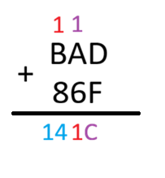
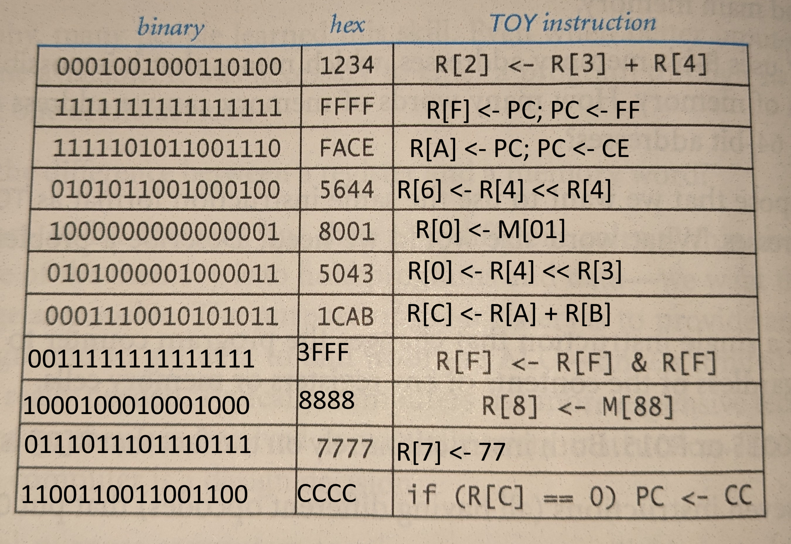

# 1

# 2
(Answers are based off the textbook) Three modern examples of programs being treated as data are: any application that has been downloaded and installed and becomes a program when launched; programming language compilers, as they accept programs as input and give machine-language programs as the output; and modern cloud computing, based on the concept of virtual machines, where a computer ones a program that was written for another computer.
# 3

